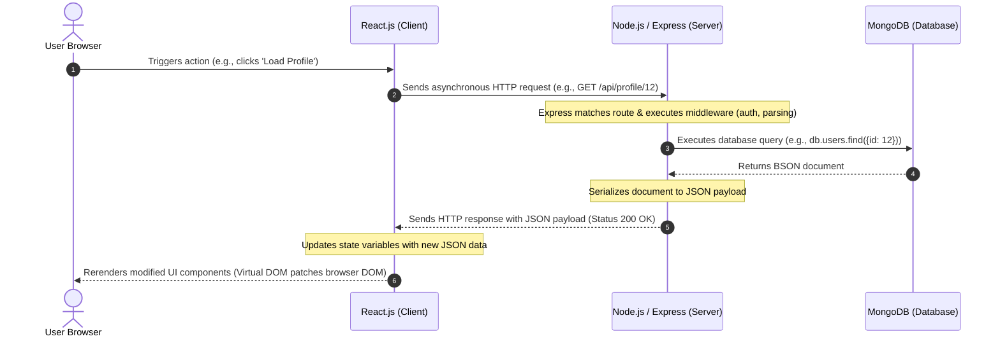

# MERN Stack Technical Report

This report provides a detailed, structured overview of the MERN (MongoDB, Express.js, React.js, Node.js) stack, analyzing its components, architecture, client-server data workflow, and scalability.

---

## 1.1 About MERN Stack

The **MERN Stack** is a robust, open-source web development framework designed to build dynamic, data-driven web applications. Comprising four key technologies—**M**ongoDB, **E**xpress.js, **R**eact.js, and **N**ode.js—the stack represents a modern approach to web development. 

The defining characteristic of the MERN stack is its **JavaScript-centric nature**. By employing JavaScript for both client-side presentation and server-side execution, MERN eliminates the context-switching traditionally required when moving between different languages (e.g., PHP, Java, or Python on the backend, and JavaScript on the frontend). It is widely classified as a Full-Stack JavaScript solution that simplifies the development lifecycle.

---

## 1.2 Importance and Applications of the MERN Stack

### Importance
* **Unified Codebase:** Developers can write the database queries, backend server logic, API endpoints, and client-side UI components entirely in JavaScript/TypeScript.
* **Massive Ecosystem:** Leverages the **npm** (Node Package Manager) ecosystem, which contains millions of reusable libraries, reducing development time and effort.
* **JSON-centric Flow:** Data flows seamlessly from the database to the frontend representation without complex object-relational mapping (ORM) translations, as MongoDB stores data in a JSON-like format (BSON) and React consumes it as native JavaScript objects.

### Applications
1. **Real-time Applications:** Chat platforms, collaborative tools (e.g., Slack-like tools, collaborative document editors) due to Node.js's event-driven, non-blocking I/O model.
2. **E-Commerce Portals:** Dynamic product catalogs, shopping carts, and checkout systems driven by React's responsive UI and MongoDB's flexible schema.
3. **Workflow Management & Dashboards:** Interactive admin panels, analytical dashboards, and project management applications (e.g., Trello or Jira-like apps).
4. **Social Media Networks:** Single-page applications requiring high interactivity, continuous updates, and real-time feeds.

---

## 1.3 Languages and Core Technologies Used

To construct a MERN stack application, developers rely on a core set of standard web languages and runtime technologies:

* **JavaScript (ES6+):** The universal programming language used across all tiers of the stack.
* **HTML5 & CSS3:** Used alongside JavaScript for layout and styling on the client side.
* **JSX (JavaScript XML):** A syntax extension for JavaScript used by React to describe what the UI should look like.
* **JSON (JavaScript Object Notation):** The standard data interchange format used for communication between the client (React), the backend server (Express/Node), and the database (MongoDB).
* **Node.js Runtime Engine:** The V8-powered runtime environment that executes JavaScript code outside the web browser.

---

## 1.4 Choice and Need for the Stack Architecture

Choosing the MERN stack architecture is driven by modern engineering priorities:

1. **Comparison with Alternative Stacks:**
   * **MERN vs. MEAN:** MERN uses React.js (virtual DOM, library, unidirectional data flow), while MEAN uses Angular (real DOM, framework, two-way data binding). React is often preferred for its lower learning curve and high rendering performance.
   * **MERN vs. LAMP (Linux, Apache, MySQL, PHP):** MERN replaces multi-language paradigms with JavaScript-only execution and transitions from relational databases (MySQL) to dynamic, schema-flexible NoSQL databases (MongoDB).
2. **Dynamic UI Requirements:** Modern users expect rich, instant-feedback interfaces without page refreshes. The React frontend handles updates in a virtual representation, patching only the changed elements in the real DOM.
3. **Microservices Compatibility:** Node.js's lightweight nature makes it highly suitable for containerization (Docker) and deploying microservice architectures.

---

## 1.5 Architectural Analysis of Stack Components

```
+-------------------------------------------------------+
|                 PRESENTATION TIER (UI)                |
|                      React.js                         |
+--------------------------+----------------------------+
                           | HTTP Requests / JSON
                           v
+--------------------------+----------------------------+
|                  APPLICATION TIER (Server)            |
|                  Node.js & Express.js                 |
+--------------------------+----------------------------+
                           | Database Queries (BSON)
                           v
+--------------------------+----------------------------+
|                   DATABASE TIER (Data)                |
|                        MongoDB                        |
+-------------------------------------------------------+
```

### MongoDB (Database Tier)
* **Type:** NoSQL, document-oriented database.
* **Architecture:** Stores data in flexible, JSON-like documents called **BSON** (Binary JSON).
* **Key Features:** Schemaless structure (documents in the same collection can have different fields), high availability via replica sets, and horizontal scaling via sharding.

### Express.js (Application Tier - Framework)
* **Type:** Minimalist, unopinionated web framework built on top of Node.js.
* **Architecture:** Operates as a series of **middleware** functions executed sequentially when a request is made to an endpoint.
* **Key Features:** Handles routing, processes request parameters, parses headers, manages cookies, and structures HTTP request/response payloads.

### React.js (Presentation Tier)
* **Type:** Declarative, component-based frontend library developed by Meta.
* **Architecture:** Uses a **Virtual DOM** to batch UI updates, calculating the minimum difference ("diffing") before updating the actual browser DOM.
* **Key Features:** Component-based modularity (reusable UI blocks), unidirectional data flow (predictable state updates), and state management hooks (`useState`, `useEffect`).

### Node.js (Application Tier - Runtime)
* **Type:** Server-side JavaScript runtime built on Google Chrome's V8 engine.
* **Architecture:** Implements an **Event-Driven, Non-blocking I/O model** powered by a single-threaded event loop (libuv under the hood).
* **Key Features:** Asynchronous execution prevents the server from blocking threads while waiting for network or disk operations, enabling it to scale efficiently.

---

## 1.6 Three-Tier Client-Server Data Workflow

A standard interaction in a MERN stack application follows a classic three-tier client-server structure. Here is the step-by-step lifecycle of an asynchronous data request:



### Flow Breakdown:
1. **User Action:** A user clicks a button or submits a form in the browser.
2. **API Call:** React intercepts the default behavior and fires an asynchronous API request (typically using `fetch` or `axios`) carrying headers and data (JSON).
3. **Routing and Middleware:** The Express server receives the request, matches it against defined route handlers, and channels it through custom middleware (e.g., authentication, request body parsers).
4. **Data Query:** The backend queries MongoDB using a driver (like Mongoose or the native MongoDB driver).
5. **Data Retrieval:** MongoDB processes the query and returns BSON documents back to the backend runtime.
6. **Response Serialization:** Express processes the retrieved data, formats it into a standard JSON payload, and sends an HTTP response status (e.g., `200 OK` or `201 Created`).
7. **UI Update:** React receives the JSON data, updates the component state, diffs the virtual DOM, and efficiently updates the browser display.

---

## 1.7 Performance Advantages and Scalability of the MERN Stack

> [!NOTE]
> The performance of a MERN application relies heavily on proper asynchronous programming practices in Node.js and efficient indexing in MongoDB.

### Performance Advantages
* **Single-Threaded Event Loop:** Node.js handles highly concurrent network connections with minimal RAM usage because it does not allocate a new thread per connection.
* **V8 Engine Speed:** The Google V8 engine compiles JavaScript code directly into native machine code before execution, providing exceptional execution speeds.
* **Virtual DOM Rendering:** React eliminates the performance bottlenecks of direct DOM access, allowing UI updates to happen smoothly at 60 frames per second.
* **No Format Conversion Overhead:** Since MongoDB stores data in BSON (binary JSON) and the frontend consumes JSON, the stack avoids CPU-intensive translation layers.

### Scalability Options
* **Horizontal Scaling (Database):** MongoDB scales horizontally via **Sharding**, which distributes data blocks across multiple machines, and **Replication**, which duplicates data for fault tolerance.
* **Backend Clustering:** Node.js applications can utilize the built-in `cluster` module or process managers like **PM2** to spawn multiple worker processes (matching CPU cores) to balance traffic load.
* **Microservice Splitting:** The unified language allows developers to break down large monolithic Express backends into micro-applications communicating via lightweight APIs or message queues.

---

## 2.1 Platform Used

The MERN stack is highly cross-platform, allowing development and deployment across diverse operating systems and cloud architectures.

### Development Platforms
* **Windows (10/11):** Widely used development environment supporting WSL (Windows Subsystem for Linux), VS Code, and local database services.
* **macOS (Intel/Apple Silicon):** Popular among developers due to its Unix-like shell architecture, which mirrors most production linux environments.
* **Linux (Ubuntu, Debian, Fedora, etc.):** The native environment for running Node.js and MongoDB instances with optimal filesystem performance.

### Deployment / Hosting Platforms
* **Frontend Hosting (React):** Vercel, Netlify, AWS S3 + CloudFront, Render, or Firebase Hosting (specialized for hosting static, client-side SPA bundles).
* **Backend Hosting (Node.js & Express.js):** Render, Heroku, AWS Elastic Beanstalk / EC2, Google Cloud Run, DigitalOcean App Platform.
* **Database Hosting (MongoDB):** MongoDB Atlas (fully-managed Cloud Database service, supporting AWS, GCP, and Azure deployment).

---

## 2.2 Hardware Requirements

A MERN stack application's hardware footprint scales with project size and expected traffic volume.

### Development Environment (Minimum vs. Recommended Specs)
* **Processor (CPU):**
  * *Minimum:* Dual-core processor (Intel Core i3 / AMD Ryzen 3).
  * *Recommended:* Quad-core or higher processor (Intel Core i5/i7, AMD Ryzen 5/7, or Apple Silicon M-series).
* **Memory (RAM):**
  * *Minimum:* 8 GB RAM (running Node server, React hot-reloading dev server, local MongoDB database, and IDE simultaneously can exhaust lower memory capacities).
  * *Recommended:* 16 GB RAM or more for smooth multitasking.
* **Storage:**
  * *Minimum:* 256 GB HDD/SSD.
  * *Recommended:* 512 GB NVMe SSD (significantly speeds up `npm install` operations, compilation, and file indexing in IDEs).

### Production/Deployment Environment (Baseline Profile)
* **Web & Application Server (Node/Express):** 
  * *Baseline:* 1 vCPU and 512 MB to 1 GB RAM (e.g., AWS `t3.micro` or equivalent Render/Heroku container) is sufficient for staging and low-traffic applications.
* **Database Server (MongoDB):**
  * *Baseline:* Shared RAM and CPU (e.g., MongoDB Atlas `M0` free tier). For production, a dedicated node with at least 2 GB RAM and dedicated SSD storage is recommended to handle indexing and database cache.

---

## 2.3 Software Requirements

The primary software tools and runtimes required to configure a complete MERN stack development and execution lifecycle include:

### Core Runtimes & Engines
* **Node.js Environment:** Active LTS (Long Term Support) version recommended (e.g., Node.js v18.x, v20.x, or v22.x).
* **Package Manager:** `npm` (bundled with Node.js), `yarn`, or `pnpm` for package installation and dependency tree management.
* **Database Server:** MongoDB Community Server (v6.0+ or v7.0+) for local development, or a MongoDB Atlas cloud connection string.

### Integrated Development Environments (IDEs) & Text Editors
* **Visual Studio Code (VS Code):** The industry standard for JavaScript/React development. Key extensions include ESLint, Prettier, and Tailwind CSS IntelliSense.
* **Alternative Editors:** WebStorm, Sublime Text, or Atom.

### Testing & Diagnostic Tools
* **API Testing Clients:** Postman, Insomnia, or the VS Code Thunder Client extension to test HTTP REST endpoints.
* **Database GUIs:** MongoDB Compass or Robo 3T for visual query design, index management, and document inspection.
* **Browser Developer Tools:** Chrome DevTools, Firefox Developer Edition, or Safari Web Inspector for UI debugging, network payload inspection, and React performance profiling (using React Developer Tools).

### Version Control & Utility Software
* **Git:** Command-line version control tool.
* **GitHub / GitLab:** Cloud repositories for code storage, collaborative pull requests, and CI/CD pipelines.
* **Command Shell:** Bash (Linux/macOS), PowerShell, or Git Bash (Windows) for CLI operations.

